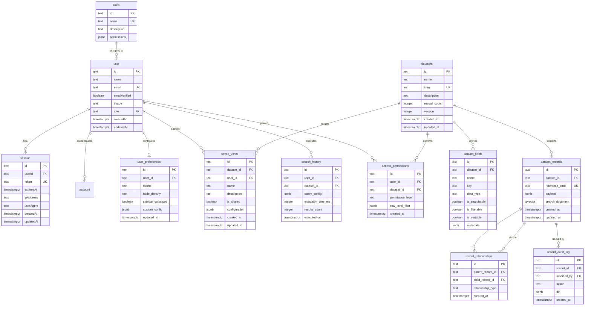

# DataScope Database Design & Relational Storage Architecture

This document establishes the relational database schema, dynamic record storage model, indexing strategies, pagination physics, analytics aggregation designs, and migration workflows for **DataScope**. It covers integration with Better Auth, PostgreSQL extension requirements, and performance tuning from 100,000 to 10,000,000 records.

---

## Table of Contents

1. [Entity-Relationship Diagram (ERD)](#1-entity-relationship-diagram-erd)
2. [Detailed Schema Data Dictionary](#2-detailed-schema-data-dictionary)
3. [The Key Storage Decision: Dynamic Dataset Record Modeling](#3-the-key-storage-decision-dynamic-dataset-record-modeling)
4. [Master Indexing Strategy Table](#4-master-indexing-strategy-table)
5. [Pagination Strategy: Keyset Cursor vs. Offset](#5-pagination-strategy-keyset-cursor-vs-offset)
6. [Analytics Aggregation & Materialized Views](#6-analytics-aggregation--materialized-views)
7. [Historical Changes & Record Audit Logging](#7-historical-changes--record-audit-logging)
8. [Drizzle Migration & 100K+ Seed Generation Strategy](#8-drizzle-migration--100k-seed-generation-strategy)
9. [Supabase & Managed Cloud Considerations](#9-supabase--managed-cloud-considerations)

---

## 1. Entity-Relationship Diagram (ERD)

DataScope integrates Better Auth's standard session model with an enterprise role-based authorization model and dynamic multi-tenant record persistence:



---

## 2. Detailed Schema Data Dictionary

### 2.1 Better Auth Integration & Role Extension
- **Decision: Extend Better Auth `user` with an explicit `role` column referencing a dedicated `roles` table**.
- **Justification**: Better Auth manages core authentication (`user`, `session`, `account`, `verification`). Adding a `role` foreign key directly to the `user` table ensures user sessions loaded by Better Auth immediately contain the user's role without requiring a secondary join, while the `roles` table defines enterprise permission sets centrally.

### 2.2 Table Definitions

#### Table: `roles`
Stores standardized enterprise access levels:
- `id` (VARCHAR(32), PK): Identifier (`admin`, `analyst`, `viewer`).
- `name` (VARCHAR(64), NOT NULL, UNIQUE): Human-readable name (`Administrator`, `Data Analyst`, `Viewer`).
- `description` (TEXT): Functional scope description.
- `permissions` (JSONB, NOT NULL, DEFAULT '[]'): Array of granular permission strings (`['dataset:read', 'dataset:export', 'admin:users']`).

#### Table: `datasets`
Represents high-level business entity collections:
- `id` (VARCHAR(36), PK): UUID v4 identifier.
- `name` (VARCHAR(128), NOT NULL): Display name (`Enterprise Customers 2026`).
- `slug` (VARCHAR(128), NOT NULL, UNIQUE): URL-safe slug (`enterprise-customers-2026`).
- `description` (TEXT): Entity description and ownership notes.
- `record_count` (BIGINT, NOT NULL, DEFAULT 0): Cached approximate total record count.
- `version` (INTEGER, NOT NULL, DEFAULT 1): Incrementing version integer used for cache invalidation.
- `created_at` / `updated_at` (TIMESTAMPTZ, NOT NULL, DEFAULT NOW()).

#### Table: `dataset_fields`
Metadata catalog describing the typed schema of each dataset:
- `id` (VARCHAR(36), PK): UUID identifier.
- `dataset_id` (VARCHAR(36), NOT NULL, FK $\rightarrow$ `datasets.id` ON DELETE CASCADE).
- `name` (VARCHAR(64), NOT NULL): Human-readable field label (`Annual Revenue`).
- `key` (VARCHAR(64), NOT NULL): Exact JSONB property key (`annual_revenue`).
- `data_type` (VARCHAR(32), NOT NULL): Enum (`text`, `number`, `currency`, `date`, `boolean`, `enum`).
- `is_searchable` (BOOLEAN, NOT NULL, DEFAULT false): Included in global text search vector.
- `is_filterable` (BOOLEAN, NOT NULL, DEFAULT true): Available in Filter Builder.
- `is_sortable` (BOOLEAN, NOT NULL, DEFAULT true): Index-backed for column sorting.
- `metadata` (JSONB, NOT NULL, DEFAULT '{}'): Enum options, formatting rules, min/max hints.

#### Table: `dataset_records`
High-performance hybrid persistence engine for dataset rows:
- `id` (VARCHAR(36), PK): UUID identifier.
- `dataset_id` (VARCHAR(36), NOT NULL, FK $\rightarrow$ `datasets.id` ON DELETE CASCADE).
- `reference_code` (VARCHAR(64), NOT NULL): External business identifier (`REC-00984102`).
- `payload` (JSONB, NOT NULL): The full structured entity attribute payload.
- `search_document` (TSVECTOR): Generated column indexing text values across the payload.
- `created_at` / `updated_at` (TIMESTAMPTZ, NOT NULL, DEFAULT NOW()).

#### Table: `record_relationships`
Represents directional associations between records (e.g., Parent Customer to Child Order):
- `id` (VARCHAR(36), PK): UUID identifier.
- `parent_record_id` (VARCHAR(36), NOT NULL, FK $\rightarrow$ `dataset_records.id` ON DELETE CASCADE).
- `child_record_id` (VARCHAR(36), NOT NULL, FK $\rightarrow$ `dataset_records.id` ON DELETE CASCADE).
- `relationship_type` (VARCHAR(64), NOT NULL): Identifier (`subsidiary_of`, `placed_order`, `assigned_contact`).
- `created_at` (TIMESTAMPTZ, NOT NULL, DEFAULT NOW()).

#### Table: `record_audit_log`
Chronological audit ledger powering the "Historical Changes" timeline:
- `id` (VARCHAR(36), PK): UUID identifier.
- `record_id` (VARCHAR(36), NOT NULL, FK $\rightarrow$ `dataset_records.id` ON DELETE CASCADE).
- `modified_by` (TEXT, NOT NULL, FK $\rightarrow$ `user.id`).
- `action` (VARCHAR(32), NOT NULL): `INSERT`, `UPDATE`, `DELETE`, `MERGE`.
- `diff` (JSONB, NOT NULL): JSON patch showing `{ field, old_value, new_value }`.
- `created_at` (TIMESTAMPTZ, NOT NULL, DEFAULT NOW()).

#### Table: `saved_views`
User-persisted analytical exploration presets:
- `id` (VARCHAR(36), PK): UUID identifier.
- `dataset_id` (VARCHAR(36), NOT NULL, FK $\rightarrow$ `datasets.id` ON DELETE CASCADE).
- `user_id` (TEXT, NOT NULL, FK $\rightarrow$ `user.id` ON DELETE CASCADE).
- `name` (VARCHAR(128), NOT NULL): Display name (`EMEA Accounts High-Value`).
- `description` (TEXT): Optional context.
- `is_shared` (BOOLEAN, NOT NULL, DEFAULT false): Accessible by all workspace members.
- `configuration` (JSONB, NOT NULL): Serialized filter AST, active sort rules, column order, density mode.
- `created_at` / `updated_at` (TIMESTAMPTZ, NOT NULL, DEFAULT NOW()).

#### Table: `search_history`
Audit and performance telemetry log for executed queries:
- `id` (VARCHAR(36), PK): UUID identifier.
- `user_id` (TEXT, NOT NULL, FK $\rightarrow$ `user.id` ON DELETE CASCADE).
- `dataset_id` (VARCHAR(36), NOT NULL, FK $\rightarrow$ `datasets.id`).
- `query_config` (JSONB, NOT NULL): Exact executed query parameters.
- `execution_time_ms` (INTEGER, NOT NULL): Database query runtime in milliseconds.
- `results_count` (INTEGER, NOT NULL): Total records matched.
- `executed_at` (TIMESTAMPTZ, NOT NULL, DEFAULT NOW()).

#### Table: `user_preferences`
Persistent user interface preferences:
- `id` (VARCHAR(36), PK): UUID identifier.
- `user_id` (TEXT, NOT NULL, UNIQUE, FK $\rightarrow$ `user.id` ON DELETE CASCADE).
- `theme` (VARCHAR(16), NOT NULL, DEFAULT 'light'): `light`, `dark`, `system`.
- `table_density` (VARCHAR(16), NOT NULL, DEFAULT 'compact'): `compact`, `comfortable`.
- `sidebar_collapsed` (BOOLEAN, NOT NULL, DEFAULT false).
- `custom_config` (JSONB, NOT NULL, DEFAULT '{}'): Custom keybindings, pinned datasets.
- `updated_at` (TIMESTAMPTZ, NOT NULL, DEFAULT NOW()).

#### Table: `access_permissions`
Dataset-level Access Control List (ACL) with optional Row-Level Security filters:
- `id` (VARCHAR(36), PK): UUID identifier.
- `user_id` (TEXT, NOT NULL, FK $\rightarrow$ `user.id` ON DELETE CASCADE).
- `dataset_id` (VARCHAR(36), NOT NULL, FK $\rightarrow$ `datasets.id` ON DELETE CASCADE).
- `permission_level` (VARCHAR(32), NOT NULL): `read`, `read_write`, `admin`.
- `row_level_filter` (JSONB): Optional restriction predicate (e.g., `{"country": "Germany"}`).
- `created_at` (TIMESTAMPTZ, NOT NULL, DEFAULT NOW()).

---

## 3. The Key Storage Decision: Dynamic Dataset Record Modeling

How should an enterprise platform store records for disparate datasets whose schema attributes differ completely?

```
┌────────────────────────────────────────────────────────────────────────┐
│                   RECORD PERSISTENCE MODEL COMPARISON                  │
├──────────────────────┬──────────────────────┬──────────────────────────┤
│ Option A: Separate   │ Option B: Pure JSONB │ Option C: Hybrid Typed   │
│ Typed Table per Set  │ Single Table         │ + JSONB Engine (CHOSEN)  │
├──────────────────────┼──────────────────────┼──────────────────────────┤
│ Requires dynamic DDL │ Maximum schema       │ Core relational identity │
│ migrations per user  │ agility; zero DDL    │ is typed & foreign-keyed;│
│ dataset; exhausts DB │ overhead; single     │ flexible attributes live │
│ catalogs; rigid.     │ table; requires GIN. │ in indexed JSONB payload.│
└──────────────────────┴──────────────────────┴──────────────────────────┘
```

### 3.1 The Selected Model: Option C (Hybrid Typed + JSONB)
- **Primary Relational Attributes**:
  - `id` (UUID PK), `dataset_id` (FK), `reference_code` (Unique business key), `created_at`, `updated_at`.
- **Dynamic Attribute Payload**:
  - `payload` (`JSONB`): Houses all domain-specific fields (`company_name`, `country`, `annual_revenue`, `account_status`, `contact_email`, `metadata`).
- **Generated Search Document Column**:
  - `search_document` (`tsvector GENERATED ALWAYS AS (to_tsvector('english', coalesce(payload->>'company_name','') || ' ' || coalesce(payload->>'country',''))) STORED`).

### 3.2 Justification for the Hybrid Choice:
1. **Zero DDL Overhead for New Datasets**: Users can register new datasets and upload novel schemas in real-time without executing risky `CREATE TABLE` DDL migrations in production.
2. **PostgreSQL JSONB Performance**: Modern PostgreSQL executes binary `JSONB` path queries (`->>`) with speeds matching native typed columns when backed by B-tree expression indexes.
3. **Cross-Dataset Relational Integrity**: A single `dataset_records` table enables universal relationship modeling (`record_relationships`) and standardized audit logging (`record_audit_log`) across all datasets.

---

## 4. Master Indexing Strategy Table

To achieve p95 search latency under 150ms across 100K to 1M rows, indexes are mathematically tailored to query patterns:

| Index Name | Table | Columns / Expressions | Index Type | Query Served / Purpose | Expected Write Cost |
| :--- | :--- | :--- | :--- | :--- | :--- |
| `idx_records_dataset_id` | `dataset_records` | `dataset_id` | B-tree | Mandatory tenant isolation predicate | Low |
| `idx_records_dataset_created`| `dataset_records` | `dataset_id, created_at DESC, id ASC` | B-tree | Default chronological table feed & tie-breaker| Low |
| `idx_records_ref_code` | `dataset_records` | `reference_code` | B-tree | Exact primary key lookup from search bar | Low |
| `idx_records_trgm_name` | `dataset_records` | `((payload->>'company_name')) gin_trgm_ops`| GIN (`pg_trgm`) | Substring search (`ILIKE '%acme%'`) | Moderate |
| `idx_records_revenue` | `dataset_records` | `dataset_id, (((payload->>'annual_revenue')::numeric))` | B-tree | Numeric range filters (`revenue > 10000`) | Low |
| `idx_records_status_country`| `dataset_records` | `dataset_id, (payload->>'account_status'), (payload->>'country')`| Composite B-tree | Multi-filter equality combinations | Moderate |
| `idx_records_search_doc` | `dataset_records` | `search_document` | GIN | Global full-text search match | Moderate |
| `idx_records_payload_gin` | `dataset_records` | `payload jsonb_path_ops` | GIN | Universal arbitrary JSONB attribute lookups | High |
| `idx_saved_views_user` | `saved_views` | `user_id, dataset_id` | B-tree | List views belonging to user | Low |
| `idx_audit_log_record` | `record_audit_log` | `record_id, created_at DESC` | B-tree | Retrieve historical timeline for record drawer | Low |

> [!NOTE]
> **Composite Index Order Rule**:
> Composite indexes follow the strict **Equality First $\rightarrow$ Range Second $\rightarrow$ Sort Third** hierarchy:
> `(dataset_id [EQ], (payload->>'account_status') [EQ], ((payload->>'annual_revenue')::numeric) [RANGE])`.

---

## 5. Pagination Strategy: Keyset Cursor vs. Offset

### 5.1 The Offset Pagination Trap at Scale
Standard SQL offset pagination (`LIMIT 25 OFFSET 50000`) forces PostgreSQL to scan 50,025 physical index tuples and discard the first 50,000, causing latency to degrade linearly:
$$\text{Query Time} \propto O(N + \text{OFFSET})$$
At page 2,000 (offset 50,000), query times on 1M rows spike from 15ms to over 800ms.

### 5.2 The Selected Primary Strategy: Keyset (Cursor-Based) Pagination
DataScope adopts **Keyset Cursor Pagination** as its primary deep navigation engine:
1. **Deterministic Cursor Construction**:
   A cursor is an opaque base64-encoded tuple containing the active sort value and the primary key:
   $$\text{Cursor} = \text{base64}(\text{sort\_value} \parallel \text{id})$$
2. **SQL Execution**:
   ```sql
   SELECT id, payload
   FROM dataset_records
   WHERE dataset_id = $1
     AND (((payload->>'annual_revenue')::numeric), id) < ($2, $3)
   ORDER BY ((payload->>'annual_revenue')::numeric) DESC, id ASC
   LIMIT 26; -- 25 items + 1 lookahead to verify hasNextPage
   ```
3. **Performance**: Keyset pagination operates at constant $O(1)$ index seek time regardless of whether browsing page 1 or page 5,000.

### 5.3 Hybrid Offset Accommodation ("Jump to Page N")
To preserve user expectations for jumping to shallow pages, offset pagination is supported **only for pages 1 through 50** (offset $\le 1,250$). Attempting to jump to page 500 displays a UI notice: *"For deep dataset navigation, please use filter constraints or directional next/previous navigation."*

---

## 6. Analytics Aggregation & Materialized Views

Analytics dashboards calculate aggregations (e.g., *Total Revenue by Country*, *Average Deal Size by Month*).

### Strategy: Materialized Views with Concurrent Refresh
- For datasets $> 100,000$ rows, calculating live sums and group-bys on every page view consumes massive CPU.
- An automated PostgreSQL Materialized View pre-aggregates metrics hourly:
  ```sql
  CREATE MATERIALIZED VIEW mv_dataset_analytics_hourly AS
  SELECT 
    dataset_id,
    payload->>'country' AS country,
    payload->>'account_status' AS status,
    date_trunc('day', created_at) AS date_bucket,
    count(*) AS total_records,
    sum(((payload->>'annual_revenue')::numeric)) AS total_revenue,
    avg(((payload->>'annual_revenue')::numeric)) AS avg_revenue
  FROM dataset_records
  GROUP BY dataset_id, payload->>'country', payload->>'account_status', date_trunc('day', created_at);

  CREATE UNIQUE INDEX idx_mv_analytics ON mv_dataset_analytics_hourly (dataset_id, country, status, date_bucket);
  ```
- **Refresh Command**: `REFRESH MATERIALIZED VIEW CONCURRENTLY mv_dataset_analytics_hourly;` executed via a background pg_cron job.

---

## 7. Historical Changes & Record Audit Logging

Whenever a record's `payload` is mutated via the API, a database trigger or API service interceptor records a delta in `record_audit_log`:
```json
{
  "record_id": "rec_00984102",
  "modified_by": "user_214a",
  "action": "UPDATE",
  "diff": {
    "annual_revenue": { "old": 10000, "new": 15000 },
    "account_status": { "old": "Pending", "new": "Active" }
  },
  "created_at": "2026-11-13T14:20:00Z"
}
```
This payload is rendered in the Record Details Drawer as an interactive visual diff timeline.

---

## 8. Drizzle Migration & 100K+ Seed Generation Strategy

### 8.1 Migration Directory Structure
```
backend/
├── drizzle/
│   ├── 0000_initial_core_schema.sql      # Better Auth & Core Roles
│   ├── 0001_add_datasets_and_records.sql # Datasets & Hybrid Storage
│   └── 0002_create_trgm_gin_indexes.sql  # pg_trgm & GIN expressions
└── src/db/seeds/
    └── generate-sample-dataset.ts        # 100K Record Seed Engine
```

### 8.2 100,000+ Sample Dataset Generation Blueprint
To validate search performance empirically, a deterministic sample dataset script (`npm run db:seed`) generates **100,000 realistic enterprise customer records**:
- **Batch Size**: 2,500 records per multi-row SQL `INSERT` statement.
- **Runtime Budget**: Under 15 seconds total insertion time.
- **Deterministic Random Seed**: Uses a fixed PRNG seed (`seed: 42`) to guarantee identical data distributions across developer machines.
- **Realistic Distributions**:
  - `company_name`: Synthetic realistic enterprise names (`Acme Corp`, `Globex GmbH`, `Initech LLC`).
  - `country`: Weighted distribution (30% USA, 25% Germany, 15% UK, 15% France, 15% Japan).
  - `account_status`: 70% `Active`, 20% `Pending`, 10% `Suspended`.
  - `annual_revenue`: Pareto distribution (\$1,000 to \$10,000,000).
  - `created_at`: Uniformly distributed across the previous 365 days.

---

## 9. Supabase & Managed Cloud Considerations

When deploying DataScope to Supabase or managed PostgreSQL:
1. **Connection Pooling vs. Direct Ports**:
   - Application API queries use the Transaction Pooler (Port `6543`) with `pg.Pool`.
   - Drizzle migrations (`npm run db:migrate`) must use the Direct Session Port (`5432`) because Drizzle Kit requires advisory locks unavailable on transaction poolers.
2. **SSL Configuration**:
   - As implemented in `backend/src/db/client.ts`, remote host connections enforce `ssl: { rejectUnauthorized: false }`.
3. **Enabling Extensions**:
   - `pg_trgm` must be enabled prior to running index migrations: `CREATE EXTENSION IF NOT EXISTS pg_trgm;`.

