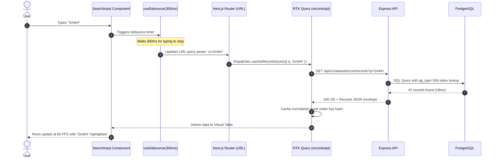

# DataScope Data Fetching & Caching Architecture

This document defines the data fetching, in-memory caching, request lifecycle, deduplication, retry, and invalidation strategies for **DataScope**. It outlines the RTK Query service design and provides explicit, exhaustive answers to all 10 mandatory data architecture questions required by the platform brief.

---

## Table of Contents

1. [Server-Side vs. Client-Side Fetching Strategy](#1-server-side-vs-client-side-fetching-strategy)
2. [RTK Query Service Architecture](#2-rtk-query-service-architecture)
3. [Answers to the 10 Mandatory Architectural Questions](#3-answers-to-the-10-mandatory-architectural-questions)
4. [Debouncing, Race Conditions & Cancellation](#4-debouncing-race-conditions--cancellation)
5. [Error Taxonomy & UI Recovery Matrix](#5-error-taxonomy--ui-recovery-matrix)
6. [Data Fetching & Cache Invalidation Sequence Diagrams](#6-data-fetching--cache-invalidation-sequence-diagrams)

---

## 1. Server-Side vs. Client-Side Fetching Strategy

DataScope utilizes a hybrid data-fetching model tailored to the performance and interactivity requirements of each screen:

| Screen / Feature | Fetching Tier | Mechanism | Architectural Reasoning |
| :--- | :--- | :--- | :--- |
| **Landing Page** (`/`) | Server-Side | Static Generation (SSG) | Zero database dependency; instant initial paint and SEO. |
| **Overview Dashboard** (`/dashboard`)| Server-Side (Initial) + Client (Poll)| RSC + RTK Query | Fast initial dashboard layout; auto-refreshes system stats. |
| **Dataset Library** (`/datasets`) | Server-Side (Prefetch) + Client | RSC + RTK Query | Fast initial catalog; instantaneous client-side tag filtering. |
| **Data Explorer** (`/explorer`) | **Client-Side (RTK Query)** | `useGetRecordsQuery` | Highly dynamic: search typing, column sorting, pagination. |
| **Advanced Search** (`/search`) | Client-Side (RTK Query) | `useExecuteSearchQuery` | Interactive visual AST query compilation. |
| **Record Details Drawer** | Client-Side (RTK Query) | `useGetRecordByIdQuery` | Lazy-loaded on row click; eliminates over-fetching in tables. |
| **Saved Views Gallery** (`/views`) | Client-Side (RTK Query) | `useGetSavedViewsQuery` | Direct mutation support (`create`, `update`, `delete`, `share`). |
| **Analytics Aggregations** | Client-Side (RTK Query) | `useGetAggregatesQuery` | Background compute with long cache TTL (5 minutes). |

---

## 2. RTK Query Service Architecture

The base API service (`frontend/src/services/baseApi.ts`) is configured with global credentials, error handling, and normalized tag definitions.

### 2.1 Cache Tag System & Endpoints Map

```
Tag Types:
  - 'Dataset'
  - 'DatasetFields'
  - 'RecordPage'
  - 'RecordDetail'
  - 'SavedView'
  - 'SearchHistory'
  - 'Analytics'
  - 'UserPreference'
```

| Endpoint Identifier | Operation | Cache Lifetime (`keepUnusedDataFor`) | Tags Provided | Tags Invalidated |
| :--- | :--- | :--- | :--- | :--- |
| `getDatasets` | Query | 300s (5 minutes) | `{ type: 'Dataset', id: 'LIST' }` | None |
| `getDatasetFields` | Query | 600s (10 minutes) | `{ type: 'DatasetFields', id: datasetId }` | None |
| `getRecords` | Query | 60s (1 minute) | `{ type: 'RecordPage', id: queryHash }` | None |
| `getRecordById` | Query | 180s (3 minutes) | `{ type: 'RecordDetail', id: recordId }` | None |
| `getRecordHistory` | Query | 180s (3 minutes) | `{ type: 'RecordDetail', id: `${recordId}_HIST` }`| None |
| `getSavedViews` | Query | 120s (2 minutes) | `{ type: 'SavedView', id: 'LIST' }` | None |
| `createSavedView` | Mutation | N/A | None | `[{ type: 'SavedView', id: 'LIST' }]` |
| `deleteSavedView` | Mutation | N/A | None | `[{ type: 'SavedView', id: 'LIST' }]` |
| `getSearchHistory` | Query | 60s (1 minute) | `{ type: 'SearchHistory', id: 'LIST' }`| None |
| `getAggregates` | Query | 300s (5 minutes) | `{ type: 'Analytics', id: queryHash }` | None |
| `updatePreferences`| Mutation | N/A | None | `['UserPreference']` |

### 2.2 Global Query Configuration Policies
- `refetchOnFocus: false`: In high-density data tables, returning focus to the browser window must **NOT** trigger background refetches that disrupt the user's scroll position.
- `refetchOnReconnect: true`: If network connectivity drops and recovers, stale table pages automatically revalidate.
- `skip: !activeDatasetId`: Queries do not execute until a valid dataset identifier is resolved.
- **Prefetching Next Page**: While the user browses Page $N$, RTK Query automatically executes `prefetch('getRecords', { ...params, page: N + 1 })` during idle moments, making next-page clicks instantaneous.

---

## 3. Answers to the 10 Mandatory Architectural Questions

### 3.1 Question 1: Why this data-fetching approach?
**Answer**:
DataScope handles dense enterprise data where queries change dynamically with every typed character, filter chip toggle, and column sort. A client-driven, normalized caching layer via RTK Query coupled with Next.js Server Component shells provides the optimal hybrid: Server Components deliver an instant, zero-JS initial layout shell, while RTK Query manages deep reactive querying in the browser with automatic request deduplication, garbage collection, and tag-based invalidation.

### 3.2 Question 2: Why RTK Query over thunks or others?
**Answer**:
Writing data-fetching with manual `createAsyncThunk` requires hundreds of lines of boilerplate to track `isLoading`, `isError`, error envelopes, and cancellation tokens. Furthermore, thunks lack automatic response deduplication—if two components request the same dataset schema simultaneously, thunks fire two duplicate HTTP requests. RTK Query eliminates this boilerplate, provides built-in query caching, deduplicates identical in-flight requests into a single promise, and handles memory cleanup automatically via `keepUnusedDataFor`.

### 3.3 Question 3: What alternatives were considered?
**Answer**:
1. *React Server Actions*: Rejected for primary table explorations because invoking Server Actions on every keystroke incurs higher roundtrip serialization latency and lacks client-side memory caching.
2. *SWR / TanStack Query*: Evaluated and recognized as strong tools, but rejected to maintain an integrated single-vendor store architecture. Since Redux Toolkit is mandated for complex table UI state (selection sets, density modes, column sizing), RTK Query provides identical capabilities without introducing duplicate store runtimes.
3. *Raw Fetch in useEffect*: Rejected unconditionally due to susceptibility to race conditions, memory leaks, and lack of caching.

### 3.4 Question 4: How to prevent unnecessary API calls?
**Answer**:
1. **Debounce Timers**: Universal text search inputs are debounced at 300ms; slider filters are debounced at 200ms.
2. **Stable Query Hashes**: RTK Query computes a deterministic serialized hash of query arguments (`dataset`, `q`, `filters`, `sort`, `page`). If the user toggles a filter off and on again, the cached result is served from memory with 0ms network latency.
3. **Conditional Query Skipping**: The `skip` parameter halts query execution if mandatory arguments (e.g., `datasetId`) are absent.
4. **Fine-Grained Column Selection**: Table requests specify `cols=id,name,revenue`, preventing the backend from retrieving unneeded heavy JSONB payload attributes.

### 3.5 Question 5: How to handle multiple simultaneous requests?
**Answer**:
1. **Request Deduplication**: If multiple components mount simultaneously and call `useGetDatasetFieldsQuery('cust_1')`, RTK Query intercepts the duplicate calls and dispatches exactly one physical HTTP request over the wire.
2. **AbortControllers**: When a user changes search parameters while a previous request is still pending, RTK Query automatically aborts the earlier in-flight HTTP request via the browser `AbortController`, releasing backend connections.

### 3.6 Question 6: How to manage stale data?
**Answer**:
DataScope uses **Optimistic Tag Invalidation**:
- Mutations (e.g., saving a view, updating a record) declare `invalidatesTags: ['SavedView']`.
- RTK Query immediately flags cached data matching those tags as invalid and automatically triggers background revalidation for all active listeners.
- Table records have a default TTL of 60 seconds. A subtle `"Sync: 2m ago"` indicator alerts users to data age, with a manual `"Refresh (R)"` trigger.

### 3.7 Question 7: How to handle API failures?
**Answer**:
1. **Categorized Error Envelopes**: Errors are mapped into standardized domains: Network Outage, Authorization Expired, Validation Error, Query Timeout, or Internal Server Error.
2. **Exponential Backoff**: Transient network errors (502, 503, 504, or network disconnects) trigger automatic retries:
   $$\text{Delay}(n) = \min(1000 \times 2^n + \text{jitter}, 8000\text{ms})$$
   retrying up to 3 times before displaying a retryable error boundary card.
3. **Non-Destructive Degradation**: If an update fails, the table retains its existing cached records and displays a non-blocking toast warning rather than clearing the screen.

### 3.8 Question 8: How to synchronize frontend state after data changes?
**Answer**:
DataScope maintains a **Single Source of Truth** architecture:
- When a record is mutated or a view is deleted, the backend returns the updated entity in a standard JSON envelope.
- RTK Query invalidates the associated tag (`RecordDetail` or `SavedView`), causing active hooks to re-fetch clean server state.
- For high-frequency row selections, state lives locally in Redux `uiPreferenceSlice`, completely decoupled from server queries to prevent query invalidation during selection.

### 3.9 Question 9: How to handle slow connections?
**Answer**:
1. **Content-Shaped Skeletons**: Rather than rendering blank screens or generic center spinners, skeleton pulse loaders immediately occupy the exact dimensions of the target table rows, preserving zero cumulative layout shift (CLS = 0).
2. **Optimistic UI Updates**: Toggling saved view bookmarks or row selections updates the UI instantly (0ms) before the network request finishes. If the request fails, the action rolls back gracefully.
3. **Lightweight Response Projections**: Search endpoints return lightweight tabular summaries (only requested fields), deferring heavy JSONB fields until the user opens the Record Detail Drawer.

### 3.10 Question 10: How does the solution behave with millions of records?
**Answer**:
The frontend remains completely agnostic to total database size because it **NEVER streams or buffers full record sets into browser memory**:
1. **Windowed Virtualization (TanStack Virtual)**: The DOM never renders more than ~35 rows at any time, maintaining constant 60 FPS scrolling whether the backend contains 1,000 or 10,000,000 records.
2. **Capped Page Offsets & Keyset Cursors**: The frontend requests fixed page chunks (`pageSize: 25 | 50 | 100`). Beyond deep offsets, the UI transitions seamlessly to Keyset Cursor pagination, preventing database memory exhaustion.
3. **Sub-second JSON Serialization**: By requesting strictly projected column keys, payload sizes over the wire stay below 45 kB per page.

---

## 4. Debouncing, Race Conditions & Cancellation

```
┌────────────────────────────────────────────────────────────────────────┐
│                      INPUT DEBOUNCE SPECIFICATIONS                     │
├──────────────────────────┬──────────────┬──────────────────────────────┤
│ Input Control            │ Delay (ms)   │ Rationale                    │
├──────────────────────────┼──────────────┼──────────────────────────────┤
│ Global Search Text (q)   │ 300ms        │ Allows natural typing rhythm │
│ Numeric Range Slider     │ 200ms        │ Smooth slider dragging       │
│ Column Filter Text       │ 300ms        │ Prevents interim keystrokes  │
│ Dropdown Select (Enum)   │ 0ms (Instant)│ Explicit deliberate click    │
│ Pagination Click         │ 0ms (Instant)│ Explicit user intent         │
└──────────────────────────┴──────────────┴──────────────────────────────┘
```

### Race Condition Elimination
In rapid typing scenarios, Request A (sent at $t=0$) might complete *after* Request B (sent at $t=300\text{ms}$). RTK Query inherently solves this by pairing each query hook with an internal incrementing sequence ID; responses from earlier, superseded requests are discarded automatically.

---

## 5. Error Taxonomy & UI Recovery Matrix

| Error Domain | HTTP Status | Root Cause | UI Presentation & Recovery Action |
| :--- | :--- | :--- | :--- |
| **Network Failure** | `0 / NetworkError` | Internet disconnected, API down | Floating Toast: *"Offline. Reconnecting..."* Auto-retries with backoff. |
| **Authentication** | `401 Unauthorized` | Session expired, invalid cookie | Modal Alert: *"Session expired."* Redirects to `/login` with return URL. |
| **Authorization** | `403 Forbidden` | Insufficient role or dataset ACL | Inline EmptyState: *"Restricted Dataset. Contact your administrator."* |
| **Validation Error** | `422 Unprocessable` | Malformed filter, invalid operator| Form Alert: Highlights invalid filter chip with specific error message. |
| **Query Timeout** | `408 / 504 Gateway` | Unindexed query took >3000ms | Warning Card: *"Query took too long. Please narrow your date range."* |
| **Server Crash** | `500 Server Error` | Unhandled backend exception | Error Boundary Card with technical error ID and *"Report Issue"* button. |

---

## 6. Data Fetching & Cache Invalidation Sequence Diagrams

### 6.1 Search Input to Render Sequence



### 6.2 Mutation & Cache Invalidation Sequence

```mermaid
sequenceDiagram
    autonumber
    actor Analyst as User
    participant Modal as SaveViewModal
    participant RTK as RTK Query (savedViewsApi)
    participant API as Express API
    participant DB as PostgreSQL

    Analyst->>Modal: Enters "EMEA Q3 High Value" & clicks "Save"
    Modal->>RTK: createSavedView({ name: 'EMEA Q3', filters: {...} })
    RTK->>API: POST /api/v1/saved-views
    API->>DB: INSERT INTO saved_views ...
    DB-->>API: Saved view record created
    API-->>RTK: 201 Created + View Entity
    Note over RTK: Invalidates tag: { type: 'SavedView', id: 'LIST' }
    RTK->>API: Automatically re-fetches GET /api/v1/saved-views
    API->>DB: SELECT * FROM saved_views
    DB-->>API: Updated view list
    API-->>RTK: 200 OK + Updated List
    RTK-->>Modal: Modal closes; View Tab Strip displays new view tab
```

