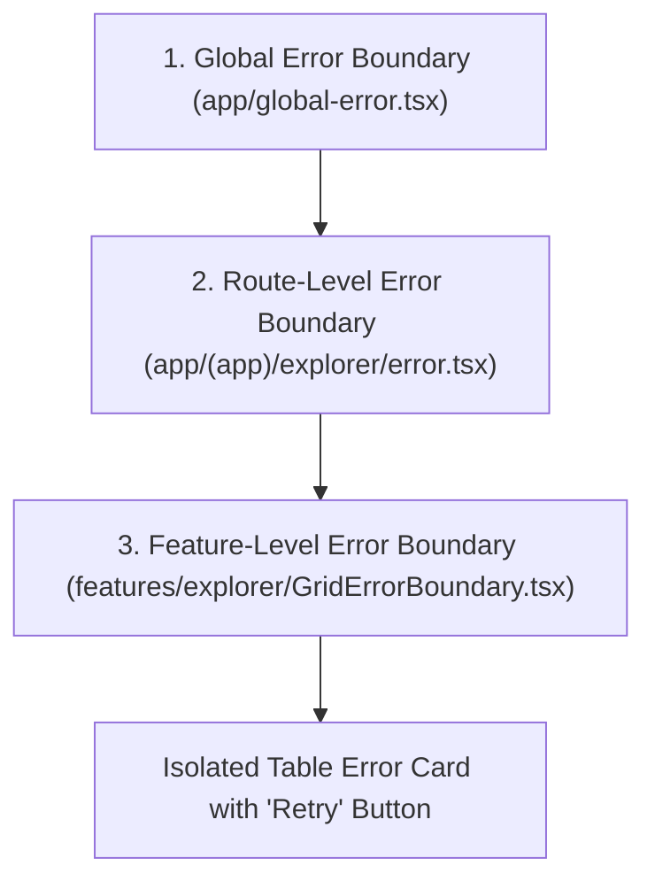

# DataScope Frontend Architecture & Engineering Specification

This document details the frontend system design for **DataScope**, implemented with Next.js (App Router), React 19, TypeScript, Redux Toolkit, and Tailwind CSS. It outlines the modular directory structure, layer boundaries, Server vs. Client component boundaries, error handling strategies, render performance optimizations, and strict developer conventions.

---

## Table of Contents

1. [Modular Feature-Based Folder Tree](#1-modular-feature-based-folder-tree)
2. [Architectural Layers & Dependency Direction](#2-architectural-layers--dependency-direction)
3. [Server vs. Client Components Matrix](#3-server-vs-client-components-matrix)
4. [App Router Route Hierarchy & Protected Shell](#4-app-router-route-hierarchy--protected-shell)
5. [Error Boundaries & Resilient Skeleton Loading](#5-error-boundaries--resilient-skeleton-loading)
6. [Render Performance & Memoization Governance](#6-render-performance--memoization-governance)
7. [Checklist: How to Add a New Feature](#7-checklist-how-to-add-a-new-feature)

---

## 1. Modular Feature-Based Folder Tree

To avoid monolithic code sprawl, `frontend/src` is organized into self-contained feature modules alongside shared infrastructure:

```
frontend/src/
├── app/                                # Next.js App Router root
│   ├── (public)/                       # Public route group (Landing, Auth)
│   │   ├── page.tsx                    # Public marketing landing page
│   │   ├── login/                      # /login route
│   │   │   └── page.tsx
│   │   └── register/                   # /register route
│   │       └── page.tsx
│   ├── (app)/                          # Authenticated application route group
│   │   ├── layout.tsx                  # App shell layout (Sidebar, TopBar, StoreProvider)
│   │   ├── loading.tsx                 # Route group root skeleton
│   │   ├── error.tsx                   # Route group error boundary
│   │   ├── not-found.tsx               # 404 handler
│   │   ├── dashboard/                  # Overview dashboard route
│   │   │   └── page.tsx
│   │   ├── datasets/                   # Dataset library route
│   │   │   └── page.tsx
│   │   ├── explorer/                   # Data Explorer (Centerpiece workstation)
│   │   │   ├── page.tsx
│   │   │   └── loading.tsx
│   │   ├── search/                     # Advanced query builder route
│   │   │   └── page.tsx
│   │   ├── views/                      # Saved views management route
│   │   │   └── page.tsx
│   │   ├── history/                    # Search query history route
│   │   │   └── page.tsx
│   │   ├── analytics/                  # Aggregate charts & trends route
│   │   │   └── page.tsx
│   │   ├── settings/                   # User profile & preferences route
│   │   │   └── page.tsx
│   │   └── admin/                      # Role-gated administration
│   │       ├── users/
│   │       │   └── page.tsx
│   │       └── permissions/
│   │           └── page.tsx
│   ├── layout.tsx                      # Root HTML shell & Theme injector
│   ├── globals.css                     # Tailwind CSS & Design Token injections
│   └── not-found.tsx                   # Global 404
├── components/                         # Shared UI Primitives (Design System)
│   ├── ui/                             # Headless atomic components
│   │   ├── button.tsx
│   │   ├── input.tsx
│   │   ├── badge.tsx
│   │   ├── dialog.tsx
│   │   ├── drawer.tsx
│   │   ├── select.tsx
│   │   └── skeleton.tsx
│   ├── layout/                         # Structural shared components
│   │   ├── Navbar/                     # Component-based floating obsidian-slate navigation bar
│   │   │   ├── Navbar.tsx              # Floating pill header container, sticky top-4
│   │   │   ├── NavBrand.tsx            # Official logo (/datascope.png) & brand title
│   │   │   ├── NavLinks.tsx            # Desktop navigation links with #00D69A indicator
│   │   │   ├── NavActions.tsx          # Action cluster (Log In + gradient Get Started CTA)
│   │   │   ├── MobileMenu.tsx          # Off-canvas mobile navigation drawer
│   │   │   ├── index.ts                # Public exports
│   │   │   └── Navbar.test.tsx         # Vitest unit & accessibility tests
│   │   ├── sidebar.tsx
│   │   ├── topbar.tsx
│   │   └── page-header.tsx
│   └── feedback/                       # Shared error/empty states
│       ├── empty-state.tsx
│       ├── error-state.tsx
│       └── toast-manager.tsx
├── features/                           # Self-contained domain modules
│   ├── landing/                        # Landing page public features
│   │   ├── components/                 # Hero, CenteredHeroHeader, IsometricDataStage, IsometricDataEngine
│   │   └── constants/                  # hero.ts (Centralized copy and telemetry data)
│   ├── auth/                           # Authentication logic
│   │   ├── components/                 # LoginForm, RegisterForm
│   │   ├── hooks/                      # useSession, useRole
│   │   ├── types/                      # AuthUser, Session
│   │   └── utils/                      # Auth validators
│   ├── datasets/                       # Dataset catalog & metadata
│   │   ├── components/                 # DatasetCard, DatasetGrid
│   │   ├── hooks/                      # useDatasetList
│   │   └── types/                      # Dataset, DatasetField
│   ├── explorer/                       # Data Explorer & Virtual Grid
│   │   ├── components/                 # VirtualTable, TableHeader, ColumnHeader
│   │   ├── hooks/                      # useVirtualGrid, useColumnResize
│   │   ├── types/                      # ColumnDef, GridState
│   │   └── utils/                      # Cell formatters
│   ├── filter-builder/                 # Condition tree builder
│   │   ├── components/                 # FilterBar, FilterModal, ConditionRow
│   │   ├── hooks/                      # useFilterAST
│   │   └── types/                      # FilterGroup, FilterCondition
│   ├── record-details/                 # Slide-out record drawer
│   │   ├── components/                 # RecordDrawer, JsonViewer, HistoryTimeline
│   │   └── hooks/                      # useRecordHistory
│   ├── saved-views/                    # Saved views management
│   │   ├── components/                 # ViewTabs, SaveViewModal, ViewCard
│   │   └── hooks/                      # useActiveViewSync
│   └── analytics/                      # Data charts & trend widgets
│       ├── components/                 # MetricCard, TrendLineChart, BreakdownBar
│       └── hooks/                      # useAggregationQuery
├── hooks/                              # Global shared utility hooks
│   ├── use-debounce.ts
│   ├── use-media-query.ts
│   └── use-keyboard-shortcut.ts
├── lib/                                # Third-party client instances
│   ├── auth-client.ts                  # Better Auth React client instance
│   └── utils.ts                        # cn() Tailwind class merger
├── services/                           # RTK Query API infrastructure
│   ├── baseApi.ts                      # Base API endpoint with fetchBaseQuery
│   ├── datasetsApi.ts                  # Dataset & fields endpoints
│   ├── recordsApi.ts                   # Record search, detail, history endpoints
│   ├── savedViewsApi.ts                # Saved views endpoints
│   └── analyticsApi.ts                 # Analytical aggregate endpoints
├── store/                              # Redux Toolkit global client state
│   ├── index.ts                        # Store re-exports
│   ├── store.ts                        # configureStore & RootState types
│   ├── hooks.ts                        # useAppDispatch, useAppSelector
│   ├── StoreProvider.tsx               # Next.js App Router client provider
│   └── slices/                         # Domain client slices
│       ├── authSlice.ts
│       ├── datasetSlice.ts
│       ├── searchConfigSlice.ts
│       ├── savedViewsSlice.ts
│       └── uiPreferenceSlice.ts
├── types/                              # Global shared TypeScript contracts
│   ├── api.ts                          # ApiResponse envelope & Pagination
│   └── filter.ts                       # Universal Filter Operator contracts
└── utils/                              # Pure utility functions
    ├── formatters.ts                   # Currency, Date, and Number formatters
    └── url-serializer.ts               # URL query string compression & encoding
```

---

## 2. Architectural Layers & Dependency Direction

To maintain high maintainability and prevent circular dependencies, DataScope enforces a **unidirectional dependency rule**:

```mermaid
flowchart TD
    AppPages[1. App Router Pages (Thin)]
    FeatureComps[2. Feature Components & Domain Logic]
    SharedComps[3. Shared UI Primitives (Design System)]
    StoreServices[4. Redux Store & RTK Query Services]
    CoreUtils[5. Pure Utils, Types & Auth Client]

    AppPages --> FeatureComps
    AppPages --> SharedComps
    FeatureComps --> SharedComps
    FeatureComps --> StoreServices
    SharedComps --> CoreUtils
    StoreServices --> CoreUtils
```

### Dependency Rules:
1. **Pages are Thin**: Route `page.tsx` files must not contain complex business logic or raw JSX markup exceeding 50 lines. They assemble and pass initial parameters into Feature Containers.
2. **Features Do Not Import Siblings Directly**: `features/explorer` must never directly import from `features/analytics`. Shared logic or state contracts must be lifted into `services/`, `store/`, or `types/`.
3. **Shared Components are Domain-Agnostic**: Components inside `components/ui/` (e.g., `Button`, `Dialog`, `Select`) must never import from `features/` or `services/`. They receive props and emit callbacks.

---

## 3. Server vs. Client Components Matrix

Next.js Server Components (RSC) and Client Components (`"use client"`) are deployed strategically to minimize the JavaScript payload delivered to the browser:

| Route Path | Component Type | Justification / Responsibilities |
| :--- | :--- | :--- |
| `app/layout.tsx` | **Server Component** | Injects root metadata, fonts (`next/font`), and HTML tags. |
| `app/(public)/page.tsx` | **Server Component** | Static marketing shell, SEO metadata, pre-rendered structure. |
| `app/(app)/layout.tsx` | **Server Component** | Authenticates session via Better Auth headers; passes user to shell. |
| `components/layout/Navbar/Navbar.tsx` | **Client Component** | Responsive header container, sticky positioning, mobile breakpoint awareness. |
| `components/layout/Navbar/MobileMenu.tsx` | **Client Component** | Off-canvas drawer state, backdrop overlay, keyboard light-dismiss, focus trap. |
| `components/layout/Navbar/ThemeToggle.tsx` | **Client Component** | Theme toggle interacting with `document.documentElement` and `localStorage`. |
| `components/layout/sidebar.tsx` | **Client Component** | Manages expanded/collapsed animation state, active route detection. |
| `components/layout/topbar.tsx` | **Client Component** | Listens for `Cmd+K` keyboard shortcut, theme switching toggles. |
| `app/(app)/explorer/page.tsx` | **Client Component** | Highly interactive: URL query sync, TanStack virtual grid, drag handles. |
| `features/record-details/drawer.tsx` | **Client Component** | Slide-out drawer animations, tabs, clipboard interactions. |
| `app/(app)/analytics/page.tsx` | **Client Component** | Recharts interactive SVG chart rendering and tooltip canvas. |
| `app/(app)/settings/page.tsx` | **Client Component** | Form validation, profile mutation submissions. |

---

## 4. App Router Route Hierarchy & Protected Shell

### 4.1 Route Groups
- `(public)`: Public marketing and unauthenticated access pages. Has minimal header and marketing footer.
- `(app)`: The enterprise workstation. Governed by a common authenticated shell (`layout.tsx`) that embeds the persistent Sidebar, TopBar, and Redux `StoreProvider`.

### 4.2 Protected Route Strategy
Route security is enforced through a dual-perimeter defense:
1. **Edge Middleware (`frontend/src/middleware.ts`)**:
   - Inspects the Better Auth session token cookie on incoming requests to `/(app)/*`.
   - If missing or expired, executes a fast redirect to `/login?redirect=${pathname}` before any server rendering occurs.
2. **Layout Server Guard (`frontend/src/app/(app)/layout.tsx`)**:
   - Performs a server-side session verification against Better Auth.
   - If invalid, redirects immediately. If valid, passes the verified `User` profile down to the application context.

---

## 5. Error Boundaries & Resilient Skeleton Loading

DataScope implements a **three-tier error boundary hierarchy** to ensure an isolated component error never crashes the entire application.



### Loading Skeleton Strategy
- In `loading.tsx`, skeletons mimic the exact spatial geometry of the target screen:
  - Table Skeleton: Renders a fixed toolbar block, a header row with 6 columns, and 15 simulated animated pulse rows.
  - Zero Layout Shift: The skeleton container dimensions match the final table viewport height exactly (`height: calc(100vh - 180px)`).

---

## 6. Render Performance & Memoization Governance

Rendering tables with 100+ columns or rapid keyboard navigation requires strict adherence to React performance protocols:

### 6.1 When to Memoize (`useMemo`, `useCallback`, `React.memo`)
- **MANDATORY**:
  - Virtual Table Row components must be wrapped in `React.memo()` with custom equality checks (`prevProps.record.id === nextProps.record.id && prevProps.isSelected === nextProps.isSelected`).
  - Column definition arrays passed to TanStack Table.
  - Complex filter AST to SQL translation utilities.
- **FORBIDDEN (Over-memoization)**:
  - Primitive button click handlers.
  - Basic string or number formatting calls.

### 6.2 Preventing Re-Render Cascades in Data Explorer
- The global Redux store must **NEVER** store the array of retrieved record objects.
- Record datasets live exclusively in the RTK Query cache.
- The Data Explorer table subscribes only to specific primitive selectors (e.g., `useAppSelector(selectActiveDensity)`, `useAppSelector(selectSelectedRowIds)`). A change in row selection does NOT cause unselected rows to re-render.

---

## 7. Checklist: How to Add a New Feature

When introducing a new capability (e.g., *Automated Data Exports*), engineers must follow this step-by-step architectural workflow:

1. [ ] **Types & Contracts**: Define domain interfaces in `features/<feature>/types/`.
2. [ ] **API Endpoints**: Declare RTK Query endpoints in `services/<feature>Api.ts` with appropriate cache invalidation tags.
3. [ ] **State Boundaries**: If local UI state is required, add a slice in `store/slices/`; otherwise, use URL query parameters or local React state.
4. [ ] **Feature Components**: Construct isolated presentational components in `features/<feature>/components/` using shared primitives from `components/ui/`.
5. [ ] **Thin Route Page**: Mount the feature container in `app/(app)/<route>/page.tsx`.
6. [ ] **Error & Loading Shells**: Provide tailored `loading.tsx` and `error.tsx` templates in the route directory.
7. [ ] **Accessibility Audit**: Verify keyboard traversal, focus trapping, and WCAG AA contrast compliance.
8. [ ] **Unit & Integration Tests**: Implement component tests in `__tests__/` verifying happy path and network error states.

