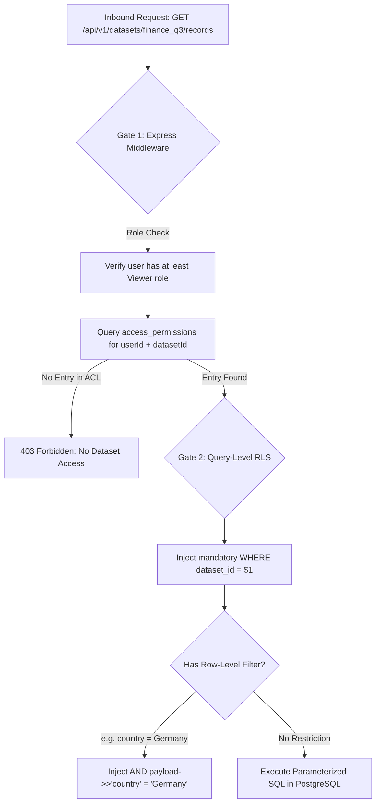

# DataScope Security, Authentication & Role-Based Access Control (RBAC)

This document specifies the security architecture, session lifecycle, role-based permissions matrix, dataset-level authorization boundaries, threat vectors, and defense-in-depth protocols for **DataScope**. It establishes strict operational guardrails ensuring that the client interface is treated as entirely untrusted.

---

## Table of Contents

1. [Authentication Engine: Better Auth & Cookie Security](#1-authentication-engine-better-auth--cookie-security)
2. [Role-Based Access Control (RBAC) Matrix](#2-role-based-access-control-rbac-matrix)
3. [Dataset-Level Access Control & Enforcement Points](#3-dataset-level-access-control--enforcement-points)
4. [Master Security Threat & Mitigation Matrix](#4-master-security-threat--mitigation-matrix)
5. [Frontend Defense & The Non-Boundary Rule](#5-frontend-defense--the-non-boundary-rule)
6. [Secrets, Rate Limiting & Audit Logging](#6-secrets-rate-limiting--audit-logging)

---

## 1. Authentication Engine: Better Auth & Cookie Security

Authentication in DataScope is powered by **Better Auth**, configured with the Drizzle PostgreSQL adapter.

### 1.1 Session Delivery & Cookie Security
Sessions are maintained via cryptographically signed `httpOnly` session cookies:

| Cookie Attribute | Development (`localhost`) | Production (`HTTPS`) | Security Rationale |
| :--- | :--- | :--- | :--- |
| `HttpOnly` | `true` | `true` | Prevents client-side scripts from reading session tokens (XSS defense). |
| `Secure` | `false` | `true` | Forces cookie transmission strictly over TLS/HTTPS encrypted connections. |
| `SameSite` | `lax` | `lax` (or `none` if cross-subdomain) | Protects against Cross-Site Request Forgery (CSRF) on ambient navigations. |
| `Domain` | `localhost` | `.datascope.enterprise.com` | Restricts cookie scope to authorized corporate origins. |
| `Max-Age` | 7 Days (`604,800s`) | 7 Days | Session lifetime with automated rolling sliding-window renewal. |

### 1.2 Cross-Origin Resource Sharing (CORS) Configuration
Because the Next.js frontend (`http://localhost:3000`) and the Express API (`http://localhost:5000`) operate across distinct ports or subdomains:
- `credentials: true`: Mandatory in Express CORS configuration to allow cookie exchange.
- `origin: CLIENT_URL`: Wildcard origins (`*`) are strictly forbidden. The API only echoes the explicitly whitelisted frontend origin.

---

## 2. Role-Based Access Control (RBAC) Matrix

DataScope enforces three standardized enterprise user roles:

1. **Administrator (`admin`)**: Full platform control, user provisioning, role assignments, dataset schema mutations, and system audits.
2. **Data Analyst (`analyst`)**: Deep exploration, advanced query building, saving/sharing team views, running analytics, and exporting datasets.
3. **Viewer (`viewer`)**: Read-only exploration, searching within assigned datasets, and bookmarking private saved views. Cannot export raw records or alter data.

### 2.1 Role-Based Permission Matrix

| Platform Capability / Endpoint Area | Administrator | Data Analyst | Viewer |
| :--- | :---: | :---: | :---: |
| **Authenticate & Manage Profile** | Yes | Yes | Yes |
| **Browse Dataset Library** | Yes | Yes | Yes |
| **Query & Search Records (Data Explorer)** | Yes | Yes | Yes |
| **View Record Details & Relationships** | Yes | Yes | Yes |
| **View Record Historical Changes Timeline** | Yes | Yes | No |
| **Create & Manage Private Saved Views** | Yes | Yes | Yes |
| **Publish Shared Saved Views (Team-Wide)** | Yes | Yes | No |
| **Run Advanced Analytics & Metric Charts** | Yes | Yes | No |
| **Export Records to CSV / Excel** | Yes | Yes | No |
| **Mutate / Edit Record Payloads** | Yes | Yes | No |
| **Create / Modify Datasets & Fields Schema** | Yes | No | No |
| **User Provisioning & Role Modification** | Yes | No | No |
| **Configure Dataset Access Permissions (ACL)**| Yes | No | No |

### 2.2 Role Storage Architecture: Custom Role Field vs. Admin Plugin
- **Decision: Custom `role` foreign key on the `user` table referencing a centralized `roles` table**.
- **Justification**: While Better Auth provides an optional admin plugin, a dedicated relational `role` foreign key guarantees that standard database queries, Drizzle schemas, and analytical views can join directly on roles without proprietary plugin abstractions.

---

## 3. Dataset-Level Access Control & Enforcement Points

Having an active user session does not confer universal access to all datasets. Access is governed by a **Two-Tier Enforcement Gate**:

---

## 4. Master Security Threat & Mitigation Matrix

To ensure absolute resilience against malicious manipulation, every attack vector is cataloged alongside its defense and proof test:

| Threat Vector | Attack Scenario | Architectural Defense & Mitigation | Verifying Security Test |
| :--- | :--- | :--- | :--- |
| **1. IDOR on Record IDs** | Attacker accesses `/datasets/hr/records/rec_999` belonging to another tenant. | Dataset ACL middleware verifies record belongs strictly to an authorized `dataset_id`. | Integration test: Viewer in Dataset A requests record from Dataset B; asserts `404 Not Found`. |
| **2. Manipulated Query Params** | User modifies URL `pageSize=500000` to trigger backend memory crash. | Zod schema strictly enforces `pageSize.refine(val <= 100)`. Max values capped. | Unit test: Send `pageSize=10000`; asserts `422 Unprocessable Entity`. |
| **3. Tampered Saved Views** | Attacker alters a saved view payload to execute unauthorized analytical functions. | Saved view configurations are validated against the strict Zod AST schema on every run. | Test: Save view with invalid AST operator; asserts validation rejection. |
| **4. Forged Field Names** | User sends `filters.field = "__proto__"` or internal column names. | Fields are validated against the dataset's `DatasetFields` whitelist. | Test: Query with `field: 'password_hash'`; asserts `422 Unknown Field`. |
| **5. SQL Injection** | Attacker inputs `' OR 1=1 --` into the search box or filter value. | Zero string concatenation. 100% of user inputs become positional SQL parameters (`$1`). | SQLMap automated injection scan against search endpoint; asserts 0 vulnerabilities. |
| **6. DoS via Heavy Regex** | Attacker submits catastrophic backtracking regex in search filter. | Regex operations disallowed; searches restricted to `ILIKE` and `pg_trgm` operators. | Test: Send nested regex strings; asserts operator validation error. |
| **7. Export Abuse** | Viewer role bypasses UI and calls `POST /api/v1/exports/jobs` directly. | Route-level RBAC middleware (`requireRole('Data Analyst')`) halts request. | Test: Viewer auth token calls export endpoint; asserts `403 Forbidden`. |
| **8. Privilege Escalation** | Analyst edits role to `Administrator` via `PATCH /api/v1/users/me`. | Profile update endpoints ignore role fields. Role changes restricted to `/admin/users/:id/role`. | Test: Analyst sends `{ role: 'admin' }`; asserts role unchanged. |
| **9. Stored XSS in Records**| Malicious actor imports records containing ``. | React auto-escapes JSX strings. Table cells render plain text; HTML rendering forbidden. | RTL test: Record with raw script tags renders strictly as literal text. |
| **10. Session Fixation** | Attacker preserves session token across login boundaries. | Better Auth rotates session token identifier immediately upon credential verification. | Auth test: Compare session cookie before and after login; asserts token change. |

---

## 5. Frontend Defense & The Non-Boundary Rule

> [!CAUTION]
> **The Frontend is Never a Security Boundary**:
> Next.js route middleware and client-side conditional UI rendering (e.g., hiding the Export button from Viewers) are strictly **User Experience conveniences**, not security barriers. A malicious actor can easily manipulate client JavaScript, spoof Redux state, or execute raw HTTP requests via `curl`.
> **Every security policy, role check, and record permission is enforced authoritatively on the Express API server.**

---

## 6. Secrets, Rate Limiting & Audit Logging

### 6.1 Environment Secrets Management
- All secrets (`BETTER_AUTH_SECRET`, `DATABASE_URL`, `DIRECT_URL`) are injected via environment variables and never committed to version control.
- Frontend code references only variables prefixed with `NEXT_PUBLIC_` (`NEXT_PUBLIC_API_URL`). Database connection strings are never exposed to client bundles.

### 6.2 Rate Limiting Policies (Express Rate Limiter)
- **Public Auth Endpoints** (`/api/auth/*`): 10 requests per minute per IP (prevents brute-force credential stuffing).
- **Search & Record Endpoints** (`/api/v1/datasets/*/records*`): 120 requests per minute per user session (allows rapid debounced filtering while blocking denial-of-service scrapers).
- **Export Endpoints** (`/api/v1/exports/*`): 5 export jobs per hour per user.

### 6.3 Security Audit Logging
Critical administrative actions (user role alterations, permission grants, dataset deletions) write immutable records to an append-only security log containing:
`{ timestamp, actorUserId, action, targetEntity, ipAddress, userAgent, outcome }`.

