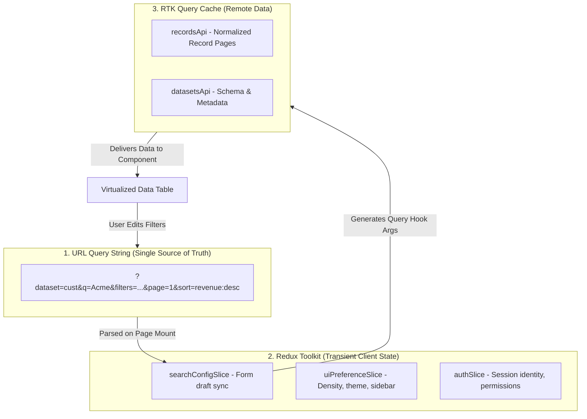
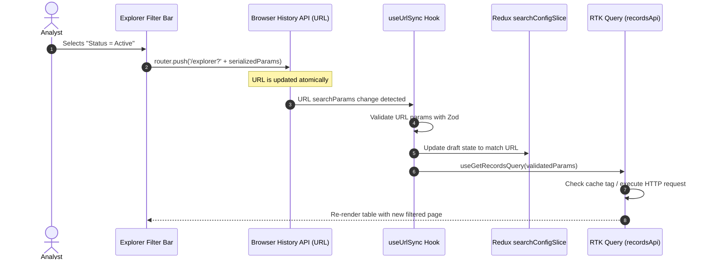

# DataScope State Management Architecture

This document establishes the canonical state classification, boundaries, synchronization mechanisms, and serialization rules for **DataScope**. It details the Redux Toolkit store architecture, URL query-parameter schema, and state ownership principles required to manage high-throughput enterprise data explorations.

---

## Table of Contents

1. [State Classification Matrix & Hierarchy](#1-state-classification-matrix--hierarchy)
2. [Redux Store Architecture & Slice Specifications](#2-redux-store-architecture--slice-specifications)
3. [URL State: The Canonical Exploration Source of Truth](#3-url-state-the-canonical-exploration-source-of-truth)
4. [Synchronization Engine: URL ↔ Redux ↔ RTK Query](#4-synchronization-engine-url--redux--rtk-query)
5. [Architectural Alternatives Considered & Evaluated](#5-architectural-alternatives-considered--evaluated)

---

## 1. State Classification Matrix & Hierarchy

To eliminate duplicate state, synchronization bugs, and memory leaks, every variable in DataScope belongs to exactly one category:

| State Tier | Owning Mechanism | Persistence & Scope | Concrete DataScope Examples |
| :--- | :--- | :--- | :--- |
| **URL State** | Browser Query String | Shareable, Bookmarkable, History-traversable | Active dataset ID, search keyword `q`, filter conditions JSON, sort rules, page offset, visible columns |
| **Server State** | RTK Query Cache | Cached in-memory, auto-garbage collected, tagged | Paginated record lists, dataset field schemas, saved view lists, user activity history, system stats |
| **Global Client State** | Redux Toolkit Slices | In-memory session, global across routes | Active session user, active drawer record ID, selected table row IDs, density mode, sidebar collapsed |
| **Component State** | React `useState` / `useReducer` | Local to component lifecycle | Modal open/close, hover tooltip visibility, cell inline editing buffer, column resize drag coordinates |



---

## 2. Redux Store Architecture & Slice Specifications

The Redux store (`frontend/src/store/`) manages global client interactions.

> [!CAUTION]
> **Strict Memory Rule: No Record Arrays in Redux**:
> Redux must **NEVER** store the array of fetched record rows (`records: Record[]`). Storing 25,000+ dynamic records in Redux causes severe state serialization overhead, bloating memory and degrading DevTools performance. Record data belongs exclusively in RTK Query.

### 2.1 `authSlice`
- **Purpose**: Tracks active user profile, assigned enterprise role, and session expiration state.
- **State Interface**:
  ```ts
  interface AuthState {
    user: {
      id: string;
      email: string;
      name: string;
      role: "Administrator" | "Data Analyst" | "Viewer";
      permissions: string[];
    } | null;
    isAuthenticated: boolean;
    sessionExpiresAt: string | null;
  }
  ```
- **Actions**: `setSession(user)`, `clearSession()`, `updateUserRole(role)`.
- **Selectors**: `selectCurrentUser`, `selectUserRole`, `selectHasPermission(perm)`.

### 2.2 `datasetSlice`
- **Purpose**: Manages the currently active dataset context and schema field definitions.
- **State Interface**:
  ```ts
  interface DatasetState {
    activeDatasetId: string | null;
    activeDatasetSlug: string | null;
    cachedFields: Record<string, DatasetFieldDef[]>; // Keyed by datasetId
  }
  ```
- **Actions**: `setActiveDataset(id, slug)`, `setCachedFields(datasetId, fields)`.
- **Selectors**: `selectActiveDatasetId`, `selectActiveFields`.

### 2.3 `searchConfigSlice`
- **Purpose**: Buffers in-progress filter edits in the query modal before applying them to the URL.
- **State Interface**:
  ```ts
  interface SearchConfigState {
    draftKeyword: string;
    draftFilterGroup: FilterGroup;
    isBuilderModalOpen: boolean;
    activeValidationErrors: Record<string, string>;
  }
  ```
- **Actions**: `setDraftKeyword(text)`, `addFilterCondition(condition)`, `removeFilterCondition(id)`, `resetDraftFilters()`, `setBuilderModalOpen(isOpen)`.
- **Selectors**: `selectDraftFilters`, `selectIsBuilderValid`.

### 2.4 `savedViewsSlice`
- **Purpose**: Tracks active saved view metadata and view creation dialog state.
- **State Interface**:
  ```ts
  interface SavedViewsState {
    activeViewId: string | null;
    isDirty: boolean; // True if filters differ from saved view definition
    isSaveModalOpen: boolean;
  }
  ```
- **Actions**: `setActiveViewId(id)`, `markViewDirty(isDirty)`, `setSaveModalOpen(isOpen)`.
- **Selectors**: `selectActiveViewId`, `selectIsViewDirty`.

### 2.5 `uiPreferenceSlice`
- **Purpose**: User preferences for display density, theme, and layout geometry.
- **State Interface**:
  ```ts
  interface UIPreferenceState {
    theme: "light" | "dark" | "system";
    tableDensity: "compact" | "comfortable";
    isSidebarCollapsed: boolean;
    activeDetailRecordId: string | null;
    selectedRowIds: Record<string, boolean>; // Set of selected record IDs
  }
  ```
- **Actions**: `setTheme(theme)`, `setTableDensity(density)`, `toggleSidebar()`, `openRecordDrawer(recordId)`, `closeRecordDrawer()`, `toggleRowSelection(id)`, `clearAllSelections()`.
- **Selectors**: `selectTheme`, `selectDensity`, `selectActiveRecordId`, `selectSelectedRowIds`.

---

## 3. URL State: The Canonical Exploration Source of Truth

The Data Explorer's entire state is completely serialized within URL query parameters. This ensures that any analytical view can be bookmarked, shared over email, or navigated via browser Back/Forward buttons with zero loss of context.

### 3.1 Canonical Query Parameter Schema

| Parameter | Type | Required | Serialization Format | Example |
| :--- | :--- | :--- | :--- | :--- |
| `dataset` | String | Yes | Plain Slug or ID | `dataset=enterprise_customers` |
| `q` | String | No | URL-encoded string | `q=Acme%20GmbH` |
| `filters` | JSON | No | URL-encoded JSON string | `filters=%7B%22and%22%3A%5B...%5D%7D` |
| `sort` | String | No | Comma-delimited `field:dir` | `sort=revenue:desc,created_at:asc` |
| `page` | Integer | No | Positive integer (default: 1)| `page=2` |
| `pageSize`| Integer | No | 25, 50, 100 (default: 25) | `pageSize=50` |
| `cols` | String | No | Comma-delimited field keys | `cols=id,name,revenue,status` |
| `view` | String | No | UUID of loaded saved view | `view=view_8941a02b` |

### 3.2 Zod Validation Schema for URL State
```ts
import { z } from "zod";

export const FilterConditionSchema = z.object({
  id: z.string(),
  field: z.string().min(1),
  operator: z.enum([
    "eq", "neq", "contains", "not_contains", "starts_with",
    "gt", "gte", "lt", "lte", "between", "in", "is_null", "is_not_null"
  ]),
  value: z.union([z.string(), z.number(), z.boolean(), z.array(z.any())]),
});

export const FilterGroupSchema: z.ZodType<any> = z.lazy(() =>
  z.object({
    id: z.string(),
    conjunction: z.enum(["and", "or"]),
    conditions: z.array(z.union([FilterConditionSchema, FilterGroupSchema])),
  })
);

export const ExplorerUrlStateSchema = z.object({
  dataset: z.string().min(1),
  q: z.string().optional().default(""),
  filters: FilterGroupSchema.optional(),
  sort: z.string().regex(/^([a-zA-Z0-9_]+:(asc|desc),?)*$/).optional().default(""),
  page: z.coerce.number().int().positive().default(1),
  pageSize: z.coerce.number().int().refine((n) => [25, 50, 100].includes(n)).default(25),
  cols: z.string().optional(),
  view: z.string().uuid().optional(),
});
```

---

## 4. Synchronization Engine: URL ↔ Redux ↔ RTK Query

To avoid update loops, DataScope adheres to the **Unidirectional URL Loop**:



---

## 5. Architectural Alternatives Considered & Evaluated

### 5.1 React Context API
- **Evaluation**: Rejected for global client state.
- **Why**: React Context triggers re-renders across all consuming components whenever any value in the context changes. In a virtualized table with 50 columns, this causes catastrophic frame dropping during simple cell interactions.

### 5.2 Zustand
- **Evaluation**: Considered as a lightweight alternative.
- **Why Rejected**: Redux Toolkit was selected because RTK Query is natively integrated, providing unified devtools, structured slice patterns, and built-in normalization without adding separate caching libraries.

### 5.3 Redux Thunks (`createAsyncThunk`)
- **Evaluation**: Rejected for server data fetching.
- **Why**: Manual thunks require hundreds of lines of boilerplate to manage `pending`, `fulfilled`, and `rejected` actions, manual cache deduplication, refetch timers, and garbage collection. RTK Query eliminates this boilerplate entirely.

### 5.4 TanStack Query (React Query)
- **Evaluation**: Considered for server caching.
- **Why Rejected**: Since Redux Toolkit is already mandated for complex client-side workflows (selection sets, column resizing, density toggling), adopting RTK Query provides identical capabilities to TanStack Query while keeping the store unified under one state harness.

