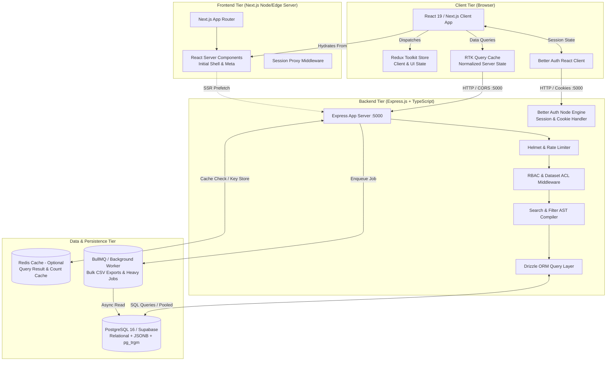
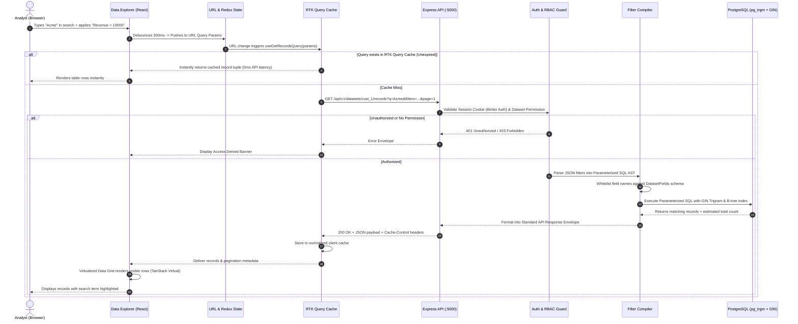
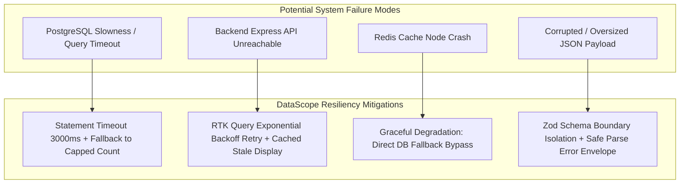

# DataScope System Design & Multi-Tier Architecture

This document defines the end-to-end multi-tier system architecture, component boundaries, execution distribution, request lifecycles, scalability progression (from 100K to 10M records), resilience strategies, and empirical target non-functional requirements for **DataScope**.

---

## Table of Contents

1. [High-Level Architecture Topology](#1-high-level-architecture-topology)
2. [Tier Responsibilities & Workload Distribution](#2-tier-responsibilities--workload-distribution)
3. [End-to-End Search Request Lifecycle](#3-end-to-end-search-request-lifecycle)
4. [Scalability Progression: 100K to 10M Records](#4-scalability-progression-100k-to-10m-records)
5. [System Failure Modes & Fault Tolerance](#5-system-failure-modes--fault-tolerance)
6. [Non-Functional Requirements & Verification Targets](#6-non-functional-requirements--verification-targets)

---

## 1. High-Level Architecture Topology

DataScope is structured as a decoupled, multi-tier enterprise architecture. The browser client interacts with a Next.js frontend tier for edge-rendered shell delivery and an Express.js API backend tier for data-dense querying, auth validation, and database operations.



---

## 2. Tier Responsibilities & Workload Distribution

A critical architectural mandate of DataScope is the strict separation of concerns across tiers to optimize security, bundle size, and throughput.

```
┌────────────────────────────────────────────────────────────────────────┐
│                      WORKLOAD SEPARATION MATRIX                        │
├────────────────────┬───────────────────────────────────────────────────┤
│ Tier               │ Primary Dedicated Responsibilities                │
├────────────────────┼───────────────────────────────────────────────────┤
│ Next.js Client     │ Virtualized DOM rendering, table interaction,     │
│ (Browser)          │ URL state sync, debouncing, local search highlight│
├────────────────────┼───────────────────────────────────────────────────┤
│ Next.js Server     │ Initial HTML document streaming, metadata, root   │
│ (RSC)              │ auth boundary redirection, lightweight edge SSR   │
├────────────────────┼───────────────────────────────────────────────────┤
│ Express API Server │ Authentication (Better Auth), RBAC enforcement,   │
│ (Node.js)          │ AST filter query compilation, Drizzle ORM queries │
├────────────────────┼───────────────────────────────────────────────────┤
│ PostgreSQL Tier    │ Indexed search (B-tree, GIN pg_trgm), JSONB data, │
│ (Database)         │ transactional integrity, aggregations, cursor sort│
├────────────────────┼───────────────────────────────────────────────────┤
│ Redis & Worker     │ Heavy analytical result caching, asynchronous     │
│ (Auxiliary)        │ bulk CSV generation, distributed query throttling │
└────────────────────┴───────────────────────────────────────────────────┘
```

### 2.1 Why a Separate Express API Instead of Next.js Server Actions / Route Handlers?
1. **Decoupled Heavy Compute**: Processing multi-condition filter trees, generating dynamic SQL, and streaming 100K record exports consumes significant CPU and memory. Keeping this independent prevents starving Next.js edge/SSR rendering threads.
2. **Deterministic Connection Pooling**: Node.js microservices running with a long-lived `pg.Pool` instance maintain persistent, warm database socket connections. Serverless Next.js functions frequently exhaust Postgres connections without complex external transaction poolers.
3. **Transport Independence**: The standalone Express API can effortlessly serve mobile clients, CLI tools, and external enterprise API integrations without tight coupling to Next.js build cycles.

---

## 3. End-to-End Search Request Lifecycle

The diagram below traces an analytical query from the user's keystroke through the entire stack to database index evaluation and back.



---

## 4. Scalability Progression: 100K to 10M Records

DataScope is designed to scale gracefully. What works seamlessly at 100K records requires distinct architectural mitigations as datasets grow to 1M and 10M rows.

| Architectural Concern | 100,000 Records (Phase 1 Baseline) | 1,000,000 Records (Phase 2 Mid-Scale) | 10,000,000 Records (Phase 3 Enterprise) |
| :--- | :--- | :--- | :--- |
| **Search Engine Strategy** | Single PostgreSQL table using `pg_trgm` GIN indexes on text columns. | Optimized PostgreSQL with generated `tsvector` columns & combined composite GIN indexes. | Dedicated Elasticsearch / OpenSearch cluster with read replica CDC sync. |
| **Counting & Total Records** | Exact `COUNT(*)` executed with search predicates. | Capped counts (`SELECT count(*) FROM (SELECT 1 ... LIMIT 10001)`). Shows `"10,000+"`. | PostgreSQL `reltuples` / statistics estimation, or Redis approximate hyperloglog counts. |
| **Pagination Mechanism** | Standard SQL `OFFSET / LIMIT` (Performant up to page ~500). | Keyset (Cursor-based) pagination mandatory beyond page 50 (`WHERE (val, id) < (:v, :id)`). | Pure Keyset cursor pagination; deep offset jumping disabled in UI. |
| **Record Storage Model** | Single `dataset_records` table with indexed `JSONB` payload. | Hybrid model: top 5 filterable columns promoted to typed columns; rest in `JSONB`. | PostgreSQL Declarative Table Partitioning by `dataset_id` or date range. |
| **Aggregations & Analytics** | Live SQL queries (`SUM`, `AVG`, `GROUP BY`) with covering indexes. | Concurrent Refresh Materialized Views updated every 15 minutes. | Pre-aggregated ClickHouse OLAP database or continuous TimescaleDB aggregates. |
| **Caching Layer** | In-memory RTK Query client-side cache + HTTP ETag. | Centralized Redis cache for hot search queries (TTL: 5 minutes). | Multi-tier Redis Cluster with automated invalidation via PostgreSQL LISTEN/NOTIFY. |
| **Database Hardware Tier** | 2 vCPU, 4GB RAM (Standard Supabase or local Docker). | 4 vCPU, 16GB RAM, SSD with dedicated provisioned IOPS. | Primary Writer + 2 Read Replicas (Read-heavy search routed to replicas). |
| **Bulk Data Exports** | Synchronous streaming CSV response via HTTP pipe. | Background asynchronous BullMQ worker saving to signed S3/R2 URLs. | Chunked parallel background export workers with email/webhook notification. |

---

## 5. System Failure Modes & Fault Tolerance



### 5.1 Failure Scenarios & Self-Healing Behaviors

1. **Slow Complex Database Query / Lock Contention**:
   - *Failure*: An analyst executes a search combining 10 unindexed regex filters across 5M records.
   - *Mitigation*: Express sets `SET statement_timeout = 3000;` on all analytical sessions. Queries exceeding 3,000ms are automatically killed by PostgreSQL.
   - *User Experience*: Returns a graceful `408 Request Timeout` envelope. UI displays: *"Query exceeded time budget (3.0s). Please narrow your filters."*
2. **Backend API Outage / Network Partition**:
   - *Failure*: Express container crashes or user loses internet connection.
   - *Mitigation*: RTK Query catches network exceptions without throwing unhandled runtime crashes. The client interface remains interactable with cached data marked with a subtle `"Offline - Viewing Cached Version"` status pill.
3. **Redis Cache Unavailability**:
   - *Failure*: Redis node runs out of memory or restarts.
   - *Mitigation*: The Express query service wraps all Redis calls in a `try/catch` fallback wrapper. If Redis fails, the query gracefully bypasses the cache and queries PostgreSQL directly while logging a silent Prometheus telemetry alert.
4. **Corrupted or Malformed Record Payload**:
   - *Failure*: A record contains unexpected nested types or missing required fields.
   - *Mitigation*: Zod parser operates in permissive mode on the table view, rendering unknown fields as raw strings or `—`, isolating errors to individual cells rather than crashing the virtualized table.

---

## 6. Non-Functional Requirements & Verification Targets

> [!IMPORTANT]
> **Empirical Targets Policy**: The metrics below represent **strict architectural performance targets** that must be validated via automated load benchmarks (`k6`, `EXPLAIN ANALYZE`, and Chrome User Experience Profiling). They are not speculative marketing claims.

```
┌────────────────────────────────────────────────────────────────────────────┐
│                    TARGET NON-FUNCTIONAL SPECIFICATIONS                    │
├──────────────────────────────┬───────────────┬─────────────────────────────┤
│ Performance Dimension        │ Target Budget │ Measurement Methodology     │
├──────────────────────────────┼───────────────┼─────────────────────────────┤
│ Search Latency (100K Rows)   │ p95 < 150ms   │ k6 load test, 50 concurrent │
│ Search Latency (1M Rows)     │ p95 < 400ms   │ k6 load test, indexed query │
│ Page Navigation Latency      │ p95 < 200ms   │ Next.js soft navigation     │
│ Table Virtual Scroll Rate    │ 60 FPS (0 jank│ Chrome DevTools Performance │
│ Total Initial Client JS      │ < 160 kB gzip │ Next.js Build Output Trace  │
│ First Contentful Paint (FCP) │ < 0.9s        │ Lighthouse Lab Audit        │
│ Cumulative Layout Shift (CLS)│ 0.000 (Zero)  │ Chrome Performance Monitor  │
│ Cumulative Database Conns    │ < 40 pool max │ pg_stat_activity monitoring │
└──────────────────────────────┴───────────────┴─────────────────────────────┘
```

