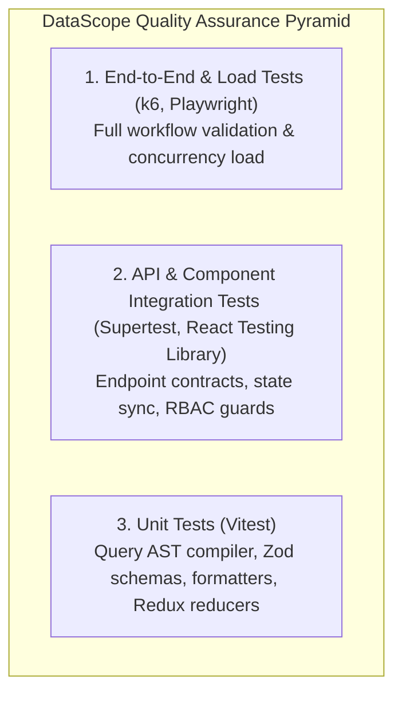
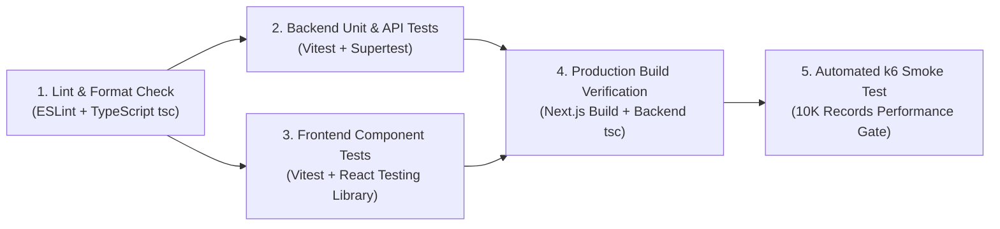

# DataScope Testing Strategy & Empirical Performance Verification Plan

This document establishes the automated testing architecture, test coverage matrix, empirical performance benchmarking methodology, and CI/CD pipelines for **DataScope**. It governs verification across unit, integration, API, and load testing layers.

---

## Table of Contents

1. [Testing Pyramid & Tooling Topology](#1-testing-pyramid--tooling-topology)
2. [Master Test Coverage Matrix](#2-master-test-coverage-matrix)
3. [Empirical Performance Benchmarking Plan](#3-empirical-performance-benchmarking-plan)
4. [Standardized Benchmark Results Template](#4-standardized-benchmark-results-template)
5. [Continuous Integration (CI) Pipeline Blueprint](#5-continuous-integration-ci-pipeline-blueprint)

---

## 1. Testing Pyramid & Tooling Topology

DataScope enforces automated quality assurance across three distinct testing tiers:



### Standardized Tooling:
- **Test Runner (Universal)**: **Vitest** for both `frontend/` and `backend/` due to its native ESM support, instant TypeScript execution via esbuild, and unified configuration.
- **Backend API Integration**: **Supertest** for testing Express routes, middleware chains, and HTTP status envelopes.
- **Frontend Component Integration**: **React Testing Library (RTL)** with `@testing-library/jest-dom` for user-centric UI testing.
- **Load & Concurrency Profiling**: **k6** for automated throughput, error rate, and p95/p99 latency stress testing.
- **Database Query Profiling**: PostgreSQL `EXPLAIN (ANALYZE, BUFFERS)` for index seek inspection.

---

## 2. Master Test Coverage Matrix

Every core requirement from the project brief is explicitly mapped to automated unit, integration, or API test cases:

| Domain Area | Test Level | Verification Harness | Example Concrete Test Case Name |
| :--- | :--- | :--- | :--- |
| **Authentication** | API / Integration | Supertest + Better Auth | `it("should reject login with invalid password returning 401")` |
| **Session Security** | API Integration | Supertest | `it("should set HttpOnly and SameSite cookie on successful authentication")` |
| **Dataset ACL** | API Integration | Supertest | `it("should block Viewer from accessing unassigned dataset returning 403")` |
| **Search Logic** | Unit Test | Vitest | `it("should compile substring search into ILIKE pg_trgm expression")` |
| **Combined Filters** | API Integration | Supertest + PostgreSQL | `it("should return records matching Country=DE AND Revenue>10000")` |
| **Multi-Column Sort** | API Integration | Supertest + PostgreSQL | `it("should sort by Revenue DESC with primary key ID ASC tie-breaker")` |
| **Keyset Pagination** | API Integration | Supertest + PostgreSQL | `it("should seek next page via cursor without scanning offset rows")` |
| **Saved Views CRUD** | API Integration | Supertest | `it("should persist view AST and return 201 Created")` |
| **Cache Invalidation**| Frontend Integration| RTL + Mock Service Worker | `it("should trigger re-fetch of saved views list after create mutation")` |
| **Debounce Behavior**| Frontend Unit | Vitest + Fake Timers | `it("should delay search dispatch by exactly 300ms after keystroke")` |
| **URL State Sync** | Frontend Integration| RTL + Memory Router | `it("should update search input when URL query string changes")` |
| **Virtual Grid Render**| Frontend Integration| RTL + TanStack Virtual | `it("should mount only visible window rows in DOM maintaining 60 FPS")` |
| **API Error Envelope**| Backend Unit | Vitest + Zod | `it("should format invalid filter operator into standard 422 envelope")` |

---

## 3. Empirical Performance Benchmarking Plan

> [!IMPORTANT]
> **No Hallucinated Performance Claims**:
> The DataScope platform strictly prohibits stating hypothetical performance victories without real benchmark measurements. All performance targets are designated as **empirical standards** to be proven through the reproducible protocol below.

### 3.1 Test Environment Specification Template
When recording benchmark results, the environment must be documented with absolute precision:
- **Host Machine / Cloud Tier**: e.g., MacBook Pro M3 (16GB RAM) or AWS `c6i.xlarge` (4 vCPU, 8GB RAM).
- **PostgreSQL Tier**: Supabase Pro or Local Docker PostgreSQL 16 (Allocated: 2 vCPU, 4GB RAM, SSD NVMe).
- **Active Record Count**: Exactly 100,000 synthetic records generated via `npm run db:seed`.
- **Concurrency**: 50 virtual users executing simultaneous random search queries.

### 3.2 Standardized Load Scenarios (Executed via k6)
1. **Scenario 1: Global Free-Text Search**:
   - Queries `q="Corp"` across 100K records using `pg_trgm` GIN index.
2. **Scenario 2: Multi-Filter Compound Query**:
   - Predicates: `Status = Active` AND `Country = Germany` AND `Revenue > 10,000`.
3. **Scenario 3: Deep Pagination Stress Test**:
   - Navigating to page 200 via standard Offset vs. Keyset Cursor.
4. **Scenario 4: Aggregate Analytics Pipeline**:
   - Calling `/api/v1/analytics/aggregate` grouping by Country and Status.

---

## 4. Standardized Benchmark Results Template

The following blank template is committed to the repository. Engineers must fill in real observed data during the formal performance verification phase:

```
┌─────────────────────────────────────────────────────────────────────────────────────────────────┐
│                          DATASCOPE EMPIRICAL BENCHMARK AUDIT SHEET                              │
├───────────────────────────────────────┬──────────────┬──────────────┬──────────────┬────────────┤
│ Test Scenario                         │ p50 Target   │ p95 Target   │ Measured p95 │ Pass/Fail  │
├───────────────────────────────────────┼──────────────┼──────────────┼──────────────┼────────────┤
│ Global Search (100K Rows, 50 VUs)     │ < 50ms       │ < 150ms      │ [To Measure] │ [Pending]  │
│ Multi-Filter Search (100K Rows)       │ < 60ms       │ < 180ms      │ [To Measure] │ [Pending]  │
│ Keyset Cursor Seek (Page 200)         │ < 30ms       │ < 80ms       │ [To Measure] │ [Pending]  │
│ Deep Offset Scan (Page 200 - Baseline)│ [Reference]  │ [Reference]  │ [To Measure] │ [Baseline] │
│ Analytics Materialized View Query     │ < 40ms       │ < 100ms      │ [To Measure] │ [Pending]  │
│ Virtual Table Scroll Frame Time       │ 16.6ms(60FPS)│ 16.6ms(60FPS)│ [To Measure] │ [Pending]  │
│ Next.js Client Bundle (Gzip)          │ < 160 kB     │ < 160 kB     │ [To Measure] │ [Pending]  │
└───────────────────────────────────────┴──────────────┴──────────────┴──────────────┴────────────┘
```

---

## 5. Continuous Integration (CI) Pipeline Blueprint

The continuous integration pipeline is defined as a multi-stage GitHub Actions workflow (`.github/workflows/ci.yml`):



### Pipeline Execution Rules:
- **Triggers**: Pull requests targeting `main` and merges to `main`.
- **Dependency Caching**: `~/.npm` cached via GitHub Actions `actions/cache@v4`.
- **Database Service**: Spawns an ephemeral `postgres:16-alpine` service container with `pg_trgm` enabled to execute real relational database tests on every pull request.

